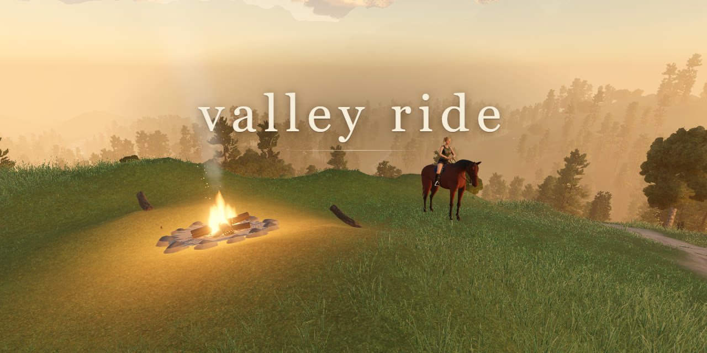

# Valley Ride

A calm horse ride across a mountain valley. Follow the trail past four lanterns to a campfire on the summit, and get there as the sun sets. No score, no fail state.

**Play: https://starknightt.github.io/valley-ride/**

Needs a browser with WebGPU: current Chrome or Edge on a desktop or laptop. It is played with a keyboard and mouse.



## Controls

| Key | |
|---|---|
| W | ride on (walk) |
| Shift | trot, hold it to gallop |
| S | rein in |
| A / D | steer |
| Space | jump a log |
| Mouse | look around (click to capture) |
| C | first person or chase camera |
| P | photo mode |
| Esc | settings |

## Run it locally

```sh
pnpm install
pnpm dev
```

Built with Claude Code (Opus 5.5 and Fable 5.2), three.js WebGPU and Blender. Asset sources and licences are in [CREDITS.md](CREDITS.md).

## Support

<p>
  <a href="https://buymeacoffee.com/prasenx"></a>&nbsp;&nbsp;
  <a href="https://github.com/sponsors/StarKnightt"></a>
</p>
