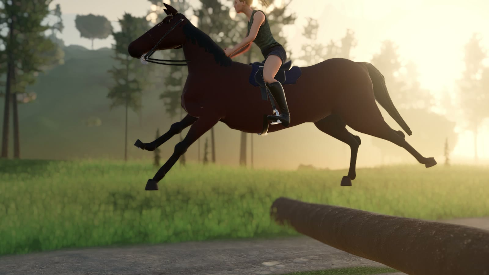
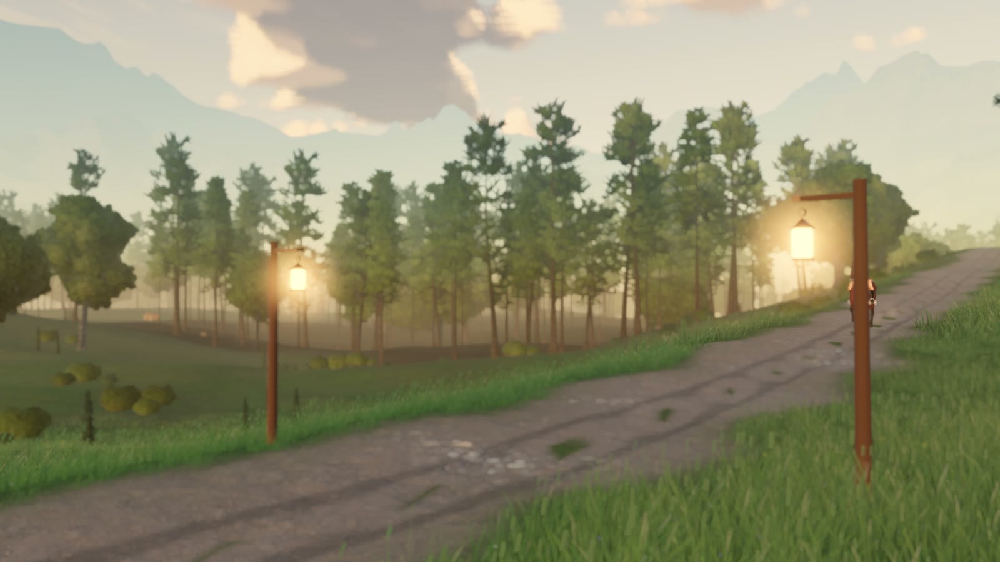
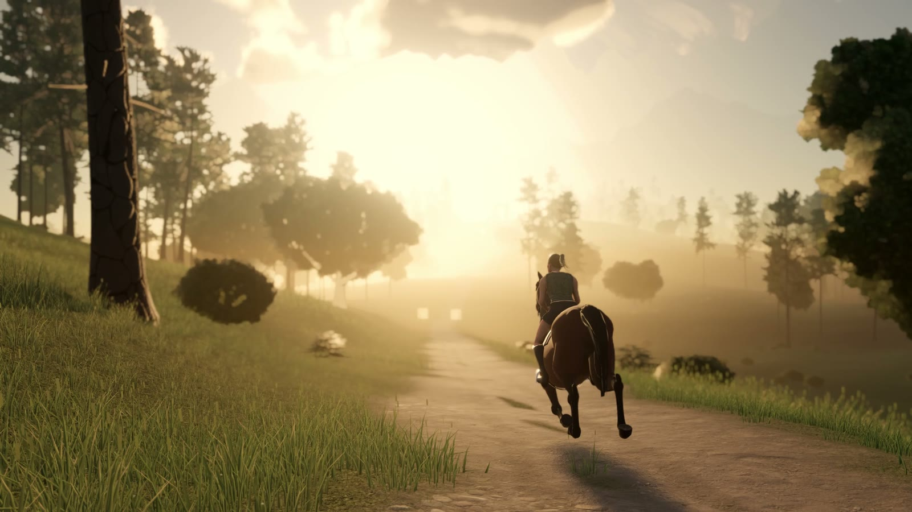
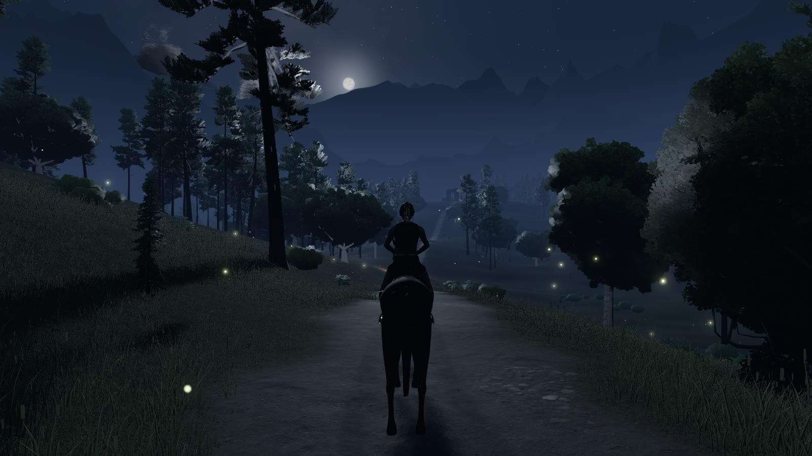
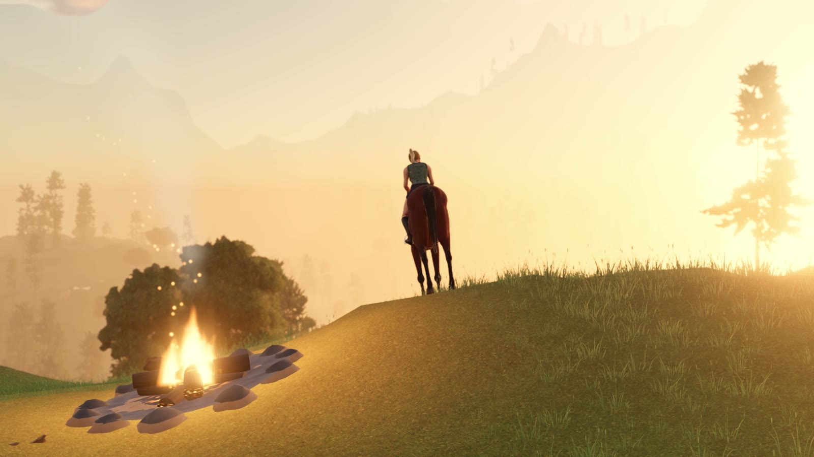

# Valley Ride

A calm horse ride across a mountain valley, in the browser. You ride a bay horse up a 2.5 km trail through meadows
and pine woods, past four pairs of lanterns, to a campfire on the summit. The sun sinks as you climb, so you arrive
at sunset; the horse slows to a stop by the fire, the rider looks out over the valley, and the ride is over. There is
no score, no enemy and no way to fail.

The horse was built in Blender and its gallop was checked frame by frame against Eadweard Muybridge's 1878 photographs
of a galloping horse before anything else in the game was made. The rider sits a forward gallop seat, holds the reins
in one line from the bit to her hands, and breathes, blinks and looks around. Morning, noon, sunset and night are a
click away, and at night the moon comes up over the trail, the lanterns light the path and fireflies drift over the
meadow.


**Play it: https://starknightt.github.io/valley-ride/**

It needs a browser with WebGPU (current Chrome or Edge on a desktop or laptop), a keyboard and a mouse. It was built
in Chrome on Windows and measured on an RTX 4060 at 1920x1080. **The first visit downloads about 74 MB before you
can ride**; from a local copy the game was ready in about 11 seconds.

## Running it locally

```
git clone https://github.com/StarKnightt/valley-ride.git
cd valley-ride
pnpm install
pnpm dev          # http://127.0.0.1:5240
pnpm build        # type-check, then a production build into dist/
pnpm preview      # serve dist/
```

You need Node.js 22 and pnpm 10. `three` (r187) is the only runtime dependency. The build uses a relative base, so
`dist/` works from any sub-path, including `/valley-ride/` on GitHub Pages; every push to `main` deploys it through
`.github/workflows/pages.yml`.



## Controls

Click the scene to capture the mouse. The first key or click also starts the sound (a browser rule).

| Input | Action |
|---|---|
| W | Ride on, at a walk |
| Shift | Trot; hold it to gallop |
| S | Rein in, then back up |
| A / D | Steer, in arcs |
| Mouse | Look around. Look past the horse's neck and it turns toward where you look |
| Space | Jump a log |
| C | Chase camera or first person |
| T | Next time of day: morning, noon, sunset, night |
| P | Photo mode: the UI hides and the camera is free |
| Esc | Free the mouse and open the settings: head bob, graphics quality (High, Medium, Low), volume |
| Enter | Ride again, on the end card |

The four round buttons at the top right do the same as T. Picking a time keeps it: the sun no longer sinks as you
climb. A gamepad works too (left stick to ride and steer, right stick to look, A to jump).

| URL option | Effect |
|---|---|
| `tod=night` | Start at `sunrise`, `morning`, `noon`, `afternoon`, `sunset`, `dusk`, `night` or an hour from 0 to 24 |
| `quality=low` | The graphics preset: `low`, `medium`, `high` or `ultra` (default: picked from the GPU's name) |
| `fps=0` | Frame cap: `auto` (default), a number, or `0` for none |
| `mute=1`, `hud=0` | No sound; no HUD |
| `webgl=1` | WebGL 2 instead of WebGPU |
| `debug=1` | GPU timings in the console |



## What is in it

- **The horse.** A bay modelled, rigged and textured in Blender by script, with a mane and tail of hair cards on
  springs. Walk, trot, canter and gallop blend into one another by speed, and from a gallop he slows through the gaits
  into a standing idle. Standing, he breathes, swishes his tail, flicks his ears, lowers and lifts his head, snorts,
  shakes and shifts his weight from one hind leg to the other, each on its own clock so nothing repeats in step.
- **The rider.** An adult woman in a fitted top, shorts and riding boots, with a blonde ponytail on springs that
  streams at the gallop. She sits a forward gallop seat with her heels down, her hands follow the horse's neck so the
  reins never go slack, and she breathes, blinks, smiles, squints into a low sun and turns to look at the valley. At a
  standstill she glances down at the horse, pats his neck and settles the reins.
- **The valley.** About 2.5 km of trail from a meadow at the valley mouth, along a river, through pine and oak woods
  and up a switchback to the summit. The ground is sculpted and textured in code from Poly Haven scans, with grass
  that moves in the wind, ferns, boulders, fallen trunks and far ranges stepping back into the haze.
- **The game.** A title card over the valley, a key hint that fades on the first input, four lantern checkpoints that
  chime and show "checkpoint 2/4", and at the summit a campfire. Reaching it eases the horse to a stop and shows
  "valley crossed" with the ride time and a quiet "ride again".
- **The day.** Left to itself, the light follows the ride: late afternoon at the start, sunset at the summit. Morning,
  noon, sunset and night can be picked at any time, and each change blends over 1 to 2.5 seconds. At night the moon
  rises over the trail with stars and a cool blue moonlight, the lanterns light the path around them, the fire burns
  brighter and lights its own smoke, and fireflies drift over the meadow.
- **Sound.** Hoofbeats that follow every footfall of each gait, breathing and snorts, wind in the pines, the river,
  birds by day, crickets and an owl at night, and the crackle of the fire, from CC0 recordings. The checkpoint chime
  and the finale are made in code.



## How it works

### The gallop test

The horse came first. `pnpm test:gallop` records one stride of the real gait code, 240 samples per stride, and checks
it against Muybridge's "Sallie Gardner" plate: the footfall order and timing, the moment of suspension with all four
legs gathered under the body, the swing of each leg, the nod of the head and the rise and fall of the body. It prints
PASS or FAIL per check and writes `gate/gallop-sheet.png`, each Muybridge frame beside our pose at the same phase. The
gallop was designed against it in `tools/gait/` and every change since has had to keep it passing.

### Rendering

Everything is drawn with three.js's WebGPURenderer and TSL node materials. The sky is a physical atmosphere from
precomputed scattering tables, with raymarched clouds, the sun and moon discs, stars and a Milky Way; the land and the
far ranges sit in the same air through an aerial-perspective fog. Shadows come from three cascades of a sun or moon
light plus a shadow map of the hills themselves, so a ridge darkens the valley floor at a low sun. The scene renders
in HDR with bloom, ACES tone mapping and a colour grade.

### Time of day and the blend

A change of time is a sweep of the clock, not a jump: it takes the short way round the dial, eased, and spends most
of its time in the twilights, where the light changes fastest. While it sweeps, the sky tables, the hills' shadows and
the image-based light follow it on alternate frames, so none of them lags and then catches up. The set of lights never
changes at runtime (the moon is the sun's light, turned; the lanterns and the fire fade by intensity), so no shader
recompiles when the time changes.

### Trees and ground

The pines and oaks were grown in Blender by script and ship with three levels of detail each; the conifers from our
earlier River Morning are mixed in. They are repacked into instanced meshes as the camera moves. The terrain is a
heightfield generated in `tools/gen-valley.ts` with masks for meadow, forest floor, rock, pebbles and the trail, and
the grass is instanced blades near the camera.



## Performance

Measured in Chrome on a Ryzen 5 7600X with an RTX 4060, at 1920x1080 on High. Riding, the game runs at about 45 to
55 fps depending on the view and the hour; switching through all four times of day ten rounds in a row held 52 fps on average with no frame
over 32 ms, and nothing compiles during a switch. A first visit downloads about 74 MB: the trees (30 MB), the terrain
textures (20 MB), the rocks and plants (10 MB), the valley's height and masks (6 MB), the rider (3 MB), the horse
(3 MB) and 1.5 MB of code. The textures are KTX2 and WebP and the meshes meshopt-compressed.

## Project structure

```
src/valley/
  core/      engine, renderer and post chain, quality presets, URL options, asset loading
  ride/      the horse, its gaits and idle, the mane, the rider and her life layer, the ride and its cameras
  game/      the game loop, checkpoints and lanterns, game sounds
  sky/       atmosphere, sky and clouds, time of day, sun and moon shadows, the hills' shadow, weather
  world/     terrain, the valley's props and campfire, far ranges, birds, colliders, the route
  veg/       grass, trees and plants
  water/     the river and the falls
  audio/     the sound engine and ambience
  ui/        title, HUD, time buttons, settings, loading
src/gaitlab/   the gait lab the gallop test runs in
tools/         the valley generator, the horse and rider builds, Blender scripts, the gallop designer
scripts/       browser checks and captures (below)
```

The scripts drive the installed Chrome on the GPU; they print the adapter on every run and stop on a software
renderer or a shader error. `pnpm test:gallop` is the gallop test. `node scripts/test-tod.mjs` switches through the
four times ten rounds in a row, then rides to the first checkpoint at night, and fails on a dropped frame, a shader
compile or a frame rate under 50. `pnpm tour` rides the whole trail on autopilot with screenshots and frame times.
`node scripts/trailer.mjs` renders the trailer frame by frame at 1080p60 with the game's own sound, encoded with
NVENC.

## Limitations

- **Under 60 fps at 1080p on High.** On the RTX 4060 it runs at about 45 to 55 fps; the forests are the cost. Medium
  and Low render at a reduced resolution with fewer plants.
- **The ruins are placeholders.** The arch and the stones by the trail are grey stand-ins built in code.
- **There is no music** yet, only the sound of the valley.
- **Night is new.** Tree branches facing the moon catch a bright white rim, and the summit at night has had less
  attention than the trail.
- **Browsers and hardware.** Only Chrome on Windows with an NVIDIA GPU was tested. The WebGL 2 fallback, Firefox,
  Safari, macOS, integrated graphics and phones were not.
- **No touch controls.** It needs a keyboard and a mouse, or a gamepad.



## How it was built

It was built in two days with Claude Code: Claude Opus 5.5 for most of it and Claude Fable 5.2 for the rider, with
Blender driven through the Blender MCP. The horse came first and nothing else was built until its gallop passed the
Muybridge test. The rider was judged only on in-game renders, against real reference photographs. Each part was
checked in the real game on the GPU before it was committed. The prompts are in [PROMPTS.md](PROMPTS.md).

## Licence and credits

The game's own code is MIT. See [LICENSE](LICENSE).

The horse, the rider's clothes, hair, tack and textures, the pine and oak trees and the valley are our own work. The
rider's body is the MakeHuman base mesh (CC0), the rocks, plants and terrain textures are Poly Haven scans (CC0), and
the sounds are CC0 recordings from freesound.org and archive.org. Nothing in the game is AI-generated.
[CREDITS.md](CREDITS.md) lists every asset with its author, source and licence.

<a href="https://buymeacoffee.com/prasenx"></a>&nbsp;<a href="https://github.com/sponsors/StarKnightt"></a>
